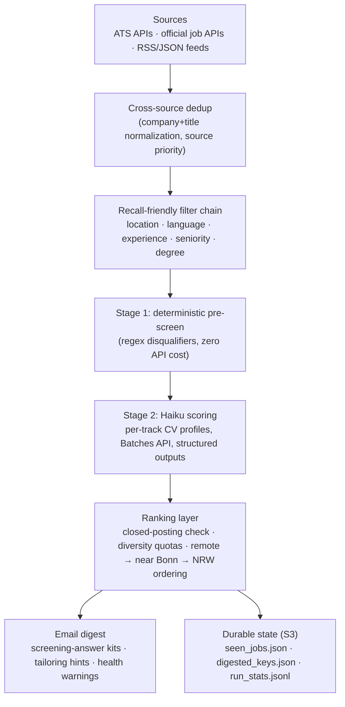

# Job Intelligence Pipeline


A Python pipeline that collects job listings, ranks them against configurable candidate profiles, and delivers a personalized digest. Deployed on AWS Fargate with scoring calibration, monitoring, and offline regression tests.

Every day, this pipeline scans **300+ company job boards and public job APIs**, filters
thousands of postings down to the handful worth applying to, scores each one against
track-specific CV profiles with Claude Haiku, and delivers a ranked email digest with
pre-drafted screening answers, keyword-gap tailoring hints and freshness badges.

It runs on **AWS Fargate**, scheduled by EventBridge, with state in S3 and secrets in
SSM Parameter Store. Deploys are automatic from `main` over GitHub OIDC, with no
long-lived AWS keys anywhere.

Built and maintained by [Sherwan Ali](https://github.com/SherwanAli0) as a real
daily-driver, and as a showcase of production-minded LLM engineering on a shoestring
budget: the Batches API, prompt caching and free keyword and pre-screen gates keep most
postings away from the model. Volume and cost figures, with the date and source of each,
are under [Measured figures](#measured-figures).

> This repository was renamed from `job-hunter` to `job-intelligence-pipeline` on 3 November 2026. Old URLs redirect, and the deploy role trusts the repository by its immutable ID-based OIDC subject. The AWS resources it deploys to (ECR repository, ECS cluster and task family, S3 prefixes, SSM paths, IAM roles, log group and schedules) keep their original `job-hunter` names on purpose.

---

## Quick start

The test suite needs no API key and no network (Python 3.11):

```bash
git clone https://github.com/SherwanAli0/job-intelligence-pipeline.git
cd job-intelligence-pipeline
pip install -r requirements.txt -c constraints.txt pytest hypothesis
pytest tests/ -q
```

Everything else needs your own profile file and keys and costs money: a real run, also
with `--dry-run`, scrapes live sources and calls the Claude API. The steps are under
[Run your own](#run-your-own); what the code does is under
[What makes it interesting](#what-makes-it-interesting) and in the [repo tour](#repo-tour).

## Architecture



**Runtime.** The whole pipeline is one container image. EventBridge Scheduler starts an
ECS Fargate task at 10:00 and at 17:00 Europe/Berlin (so daylight saving is handled for
me; the second run was off from 2026-08-18 to 2026-11-17 and asks the boards only for
what is new since the morning, see the section of 17 November below). The schedule lives
in AWS, not in this repo, so the repo cannot show its current state. The task reads its secrets from SSM
Parameter Store as SecureStrings, reads and writes state in a versioned private S3
bucket, and logs structured JSON to CloudWatch. Fargate was chosen over Lambda only after
measuring the real scrape: about 40 minutes (range 36 to 72) when it moved to Fargate in
July 2026, well past Lambda's 15-minute ceiling, and slower on some later days (one
healthy run took 2 h 03 min, which is why the overlap claim below has a 4-hour TTL). A
push to `main` runs the tests, builds the image, pushes it to ECR and registers a new
task definition revision, authenticating with GitHub OIDC against a least-privilege
role. Pushes that only change Markdown files, `cv/` or the state files do not deploy.

The stages (scrape, filter, score, rank, notify, persist) are wired together as a small
[LangGraph](https://github.com/langchain-ai/langgraph) state machine in
[graph.py](src/graph.py); the nodes call the plain functions in [main.py](src/main.py), and the
graph's only branch skips scoring when nothing new was found.

Two concurrent runs would each see the same jobs as unseen and both send a digest, so
runs take a claim in S3 (conditional write, a TTL longer than the slowest healthy run,
and an owner token so a run that overran cannot release its successor's claim) and a
second run exits cleanly instead of failing. A state file that exists but cannot be
read stops the run: carrying on with empty history would re-send old jobs.

**Sources** (public endpoints; some are unofficial scrapes of public pages): Greenhouse,
Lever, Ashby, Personio, Recruitee, SmartRecruiters and Workday endpoints across 300+
company boards (358 distinct board slugs plus 21 Workday tenants in
[config.py](src/config.py), counted 2026-11-03); the official **Bundesagentur für Arbeit**
job-search API; the **Adzuna** API; the **Brave Search** API; the JobSpy library
(`scrape_jobspy`), further job-board scrapers (see `scrape_all` in
[scrapers.py](src/scrapers.py)) and DuckDuckGo web search; and public feeds
(Arbeitnow, Remotive, WorkingNomads, WeWorkRemotely RSS) plus other public job boards. A
monthly health-check workflow probes the configured
Greenhouse, Lever, Ashby, Personio, Recruitee and SmartRecruiters boards and fails CI
when one has been removed, so the source list can't silently rot.

## What makes it interesting

**LLM scoring with per-track CV routing.** Every surviving job is classified
(AI / ML / Data Science / Data Analyst) and judged by Claude Haiku against a CV profile
*framed for that track*: a Data Scientist job is scored against the DS-framed CV,
not a generic one. A Sonnet re-score of the finalists used to follow; it was measured
at a third of every run's bill for a second opinion on an order Haiku had already set,
and removed. Structured outputs constrain each response to valid JSON; they say nothing
about whether a score is right, which is what the golden set and `calibrate.py` below
are for. A retry plus a score-0 default means a bad API moment cannot crash the run, and
a job the model returned no score for is left out of `seen_jobs.json` so the next run
tries it again, at most three attempts in total (`score_retry.json` counts them, the same
pattern as the ad-body retry). A retried job still passes through every filter, the
freshness filter included.

**A measured scoring pipeline, not vibes.** A hand-labeled golden set
([golden/](golden/golden_set.jsonl)) gates the deterministic pre-screen in CI on
every push, and [calibrate.py](src/calibrate.py) measures LLM band accuracy on demand
before any prompt edit ships. The calibration set caught a real filter bug on its
first run ("ideally 2-3 years" being read as a 3-year wall).

**Recall-then-precision filtering.** The pre-scorer filter chain is deliberately
recall-friendly (unknown location is kept), while the scorer's disqualifier is the
precision stage. Both share one source of truth ([filters.py](src/filters.py)) so the
two stages can't drift apart. The filter chain is covered by regression tests seeded
with real incidents that once killed good jobs.

**Cost engineering.** Message Batches API (50% off all tokens), prompt caching on
the per-track system prompts, a free keyword gate built from the CV, and a
deterministic pre-screen that keeps most jobs away from the API entirely. Every run
records its token usage, priced per request mode and cache TTL, as `llm_cost_usd` in its
stats line. Only postings that survive the filters and pre-screen reach the model (252
on the 2026-09-04 measurement below), not everything that was scraped.

**Observability.** Every run appends a stats line to `run_stats.jsonl` in the S3
state bucket (per-source counts, filter drops, score distribution, digest mix, token
usage). A source that historically delivers jobs but returns zero for 3 straight runs,
or one that has been silent past a grace period, triggers a red warning banner *inside
the digest email*. Sources switched off on purpose are listed as retired so their
alarm does not become noise. A digest that cannot be sent fails the run.

**Losses are measured, not assumed.** An October 2026 audit traced where suitable jobs
were lost before any rule could judge them, and each fix carries a regression test:
half the search queries never ran after the schedule went to once a day, job ads
whose page failed to load were marked seen and never retried, a location written as
just "Düsseldorf" was dropped by two board integrations, and keyword and page caps
cut student roles before they were read.

**Privacy architecture.** Scoring profiles and personal prompt context load from private S3; contact and salary facts use SSM Parameter Store; drafted answers and pipeline state use private storage. Local `personal/`, CV copies, answers and rendered AWS settings are ignored. Encrypted repository secrets support the manual calibration and rollback workflows. The current source contains no embedded CV profiles and no candidate-specific facts: facts used inside scoring prompts and rule messages come from a private `candidate_facts` key and are substituted at render time, and code comments refer to "the candidate". Search-region lists remain in source as search policy. Previous commits and old container images retain historical public data; Git history has not been rewritten. See [private profile setup](aws/private-profiles.md).

## Design decisions

- **No auto-apply, by choice.** Major ATS platforms require authenticated,
  server-side integrations for submissions, and job boards prohibit automated
  applications. This pipeline optimizes the *human* application instead:
  pre-drafted screening answers, direct apply links, keyword gaps, and follow-up
  reminders. Applying stays a deliberate act, as it should.
- **Filters fail open, the scorer fails closed.** Cheap regex filters keep
  anything ambiguous; the LLM stage (which can read the description) makes the
  precision call. False negatives are unrecoverable; false positives only cost extra scoring spend.
- **State is auditable.** Seen-job ids carry last-seen dates and prune after 60
  days; every run's behaviour is one JSON line of run stats.
- **What it hunts is configuration, not architecture.** The target changed
  completely once already: it looked for junior full-time roles until its owner's
  circumstances changed, then only for Werkstudent (working-student), internship and
  part-time (Teilzeit) IT roles, and since 2026-10-14 for entry-level full-time roles as well.
  English-language ads only: remote or hybrid anywhere
  in Germany, on-site only in North Rhine-Westphalia or the Bonn belt.
  That pivot touched the CV profiles and query lists in
  [config.py](src/config.py), one required-employment-form filter, one location-ranking rule,
  and the labels on the calibration set. The regression suite is what made it
  safe: it caught the spots where the old assumption had leaked into unrelated
  code, including a language filter that treated the word "Werkstudent" itself
  as evidence that a posting was written in German.
- **Measurement outranks intuition.** The first live run of that new target
  returned an empty digest, and the per-filter drop counters said why: the
  ad-language filter had removed 62 of the 76 reachable student roles. The
  German student market advertises in German, so the language of the
  advertisement had stopped being evidence about the job, so for three weeks
  the filter applied only the explicit language *requirement* to student
  roles. Then the owner decided that digests full of
  German ads were not worth the time and reversed it: since 2026-09-07 only
  ads whose body reads as English are sent, stub bodies are fetched in full
  before being judged, and the search runs Germany-wide for remote and
  hybrid roles (on-site only in NRW) with the digest ordered remote → near
  Bonn → NRW → elsewhere, so the smaller English pool is as large as it can be. A funnel that reports what each stage killed turns a
  silent empty inbox into a one-line diagnosis.

## Repo tour

The code is in [src/](src/). Every command in this README is run from the top folder of
the repository.

| File | Role |
|---|---|
| [main.py](src/main.py) | Orchestrator: scrape → dedup → filter → score → rank → notify |
| [scrapers.py](src/scrapers.py) | All source integrations |
| [scorer.py](src/scorer.py) | Pre-screen + Claude Haiku scoring, Batches API layer |
| [graph.py](src/graph.py) | LangGraph state machine that sequences the stages in `main.py` |
| [filters.py](src/filters.py) | Shared Germany-eligibility term lists (single source of truth) |
| [notifier.py](src/notifier.py) | HTML digest email (+ optional Notion) |
| [application_kit.py](src/application_kit.py) | Fetches real screening questions, drafts answers |
| [track.py](src/track.py) | Application tracker: funnel stats + follow-up nudges |
| [calibrate.py](src/calibrate.py) / [golden/](golden/) | Scoring calibration harness + labeled set |
| [health_check.py](src/health_check.py) | Monthly board-rot detector |
| [liveness.py](src/liveness.py) | Drops postings an employer's own API reports as closed |
| [handler.py](src/handler.py) / [storage.py](src/storage.py) | AWS entrypoint, S3 state and the overlap claim guard |
| [secrets_loader.py](src/secrets_loader.py) / [metrics.py](src/metrics.py) | SSM secrets into the environment; optional CloudWatch metrics |
| [robots.py](src/robots.py) / [robots_audit.py](src/robots_audit.py) | robots.txt rules every scraper request is checked against, and the audit that lists what they do not allow |
| [tests/](tests/) | 1,806 offline tests (`pytest --collect-only -q`, 2026-11-17), run on every push to `main` and every pull request |
| [data/](data/) | The two state files the rollback workflow commits: a snapshot from July 2026, production state lives in S3 |
| [examples/](examples/) | Fictional profile file that shows the schema of the private one |
| [aws/](aws/) | Task, schedule and IAM definitions, and `run-now.ps1` for a manual run |

## Run your own

Production runs on AWS: the [deploy workflow](.github/workflows/deploy.yml) builds the
image and registers the task definition, and [aws/](aws/) holds the task, schedule and
IAM definitions. The simplest way to run your own copy is the GitHub Actions workflow
[daily.yml](.github/workflows/daily.yml), kept as a rollback path for the AWS setup. The
workflow file still carries its cron lines; whether it is enabled is a GitHub repository
setting, not something visible in the file.

1. **Fork the repo**, edit search queries and target boards in [config.py](src/config.py), and create your private profile JSON from [the fictional schema](examples/scoring_profiles.example.json). Keep real facts in private storage, not in source.
2. **Add repository secrets** (Settings → Secrets and variables → Actions):

   | Secret | Purpose |
   |---|---|
   | `SCORING_PROFILES_JSON` | Complete private profile JSON for calibration and the rollback workflow |
   | `ANTHROPIC_API_KEY` | Scoring ([console.anthropic.com](https://console.anthropic.com)) |
   | `GMAIL_USER` / `GMAIL_APP_PASSWORD` / `GMAIL_TO` | Digest delivery (use an [app password](https://myaccount.google.com/security)) |
   | `ADZUNA_APP_ID` / `ADZUNA_APP_KEY` | Optional: [developer.adzuna.com](https://developer.adzuna.com), free tier |
   | `BRAVE_API_KEY` | Optional: Brave Search API |
   | `APPKIT_FACTS` | Optional: personal fact sheet for screening-answer drafting |
   | `NOTION_TOKEN` / `NOTION_DATABASE_ID` | Optional: Notion mirror |

3. **Enable the "Daily Job Hunt" workflow** (`gh workflow enable "Daily Job Hunt"`).
   Its cron runs at 05:00 and 13:00 UTC (twice a day, at other hours than the AWS runs);
   trigger it manually from the Actions tab to test. The Tests workflow runs on pushes
   to `main` and on pull requests.

Local run (Python 3.11, the version CI and the Docker image use; the pins in
`constraints.txt` were resolved for it):

```bash
pip install -r requirements.txt -c constraints.txt pytest hypothesis
pytest tests/ -q           # offline test suite, no API keys or network needed
export ANTHROPIC_API_KEY=sk-ant-...
export JOBHUNTER_PROFILE_FILE="$PWD/personal/scoring-profiles.json"  # your real private JSON
python src/main.py --dry-run   # NOT offline and NOT free, see below
```

**What `--dry-run` does.** It runs the real pipeline, not a simulation. It still scrapes
the live sources, sends the surviving postings to Claude (a paid Message Batches API
call), checks employer APIs for closed postings, and, if a fact sheet is configured, may
fetch Greenhouse application questions and draft answers with Haiku (the drafts are
attached in memory and not saved). It skips the email, the Notion mirror, every state
write (`seen_jobs.json`, digest memory, source registry, run stats, the answer bank
`answers.json`) and the overlap claim. Use `pytest tests/ -q` for an offline check. The
same applies to the `DRY_RUN` input of the "Run job hunt now" workflow, the `DRY_RUN`
container override and `aws/run-now.ps1 -DryRun`.

A local run without `--dry-run` sends a real digest through Gmail and rewrites
`data/seen_jobs.json`, `data/run_stats.jsonl` and the other state files in the working
directory. The two files committed in [data/](data/) are a snapshot from the July 2026
move to AWS; production state now lives in S3.

## Recall audit (11 November 2026)

One production run was traced end to end: 12,972 ads scraped, 11,092 after cross-source
dedup, 650 new, 25 after the filter chain, 19 scored, 1 emailed. The sources were not the
bottleneck; the losses were inside the pipeline. What changed:

- **Audit trail.** Every job a filter drops and every job the scorer judges is written to
  `audit_<date>.jsonl` in the state store (filter name, or score, pre-screen category and
  reason), and all scores are printed in the run log. Before this, scores under the send
  threshold were recorded nowhere.
- **JobSpy.** LinkedIn and Indeed now run in separate lanes. A LinkedIn query took about 45
  seconds against under one second on Indeed, and in the combined call Indeed waited on
  LinkedIn and was cut off with it at the 30-minute limit. LinkedIn depth is 50 results per
  query (`JOBHUNTER_LINKEDIN_RESULTS`), descriptions are no longer downloaded for postings
  already seen on an earlier day, and the log reports how many queries each site finished.
- **Language rule.** German-language ads are admitted again for student, internship and
  part-time roles and marked "GERMAN AD" in the digest; an ad that demands fluent German is
  still dropped, and full-time roles stay English-only. `JOBHUNTER_GERMAN_ADS=off` restores
  the English-only rule.
- **Location rule.** A location that names no place ("", "Germany") is passed to the scorer
  and marked "LOCATION NOT STATED" instead of being treated as on-site outside NRW. A named
  place outside NRW is still dropped. `JOBHUNTER_UNKNOWN_LOCATION=drop` restores the old rule.
- **Queries and sources.** HiWi, wissenschaftliche Hilfskraft, research-assistant, trainee
  and further junior queries were added. The Arbeitsagentur title screen accepts AI, LLM, NLP
  and research titles. Fourteen guessed Workday tenants that never existed were removed and 22
  verified ones added; the Jobicy feed was added; two dead company-page URLs were corrected.
- **Fixes.** Whole-word matching for non-EU place names and the "US only" lock ("lima" matched
  "climate", "us only" matched "bonus only"); the skill radar matches whole tokens and reads
  the loaded profile; a stopped task releases its run claim on SIGTERM; ad-body fetching
  retries throttled pages, reads schema.org JobPosting data and falls back to the employer URL.

Not measured yet: how many more relevant jobs these changes deliver. The audit file is what
makes that measurable from the next runs on.

## Internship lane and watchlist (11 November 2026)

Large employers open their summer internship intake in November. Four things stood between
those postings and the digest, and each has its own change:

- **Location.** On-site roles outside North Rhine-Westphalia were dropped before scoring. An
  on-site internship anywhere in Germany is now kept and marked `ON-SITE · RELOCATION`. Other
  forms keep the NRW rule, and an internship abroad is not covered.
- **Freshness.** Internships are kept up to 14 days after posting instead of 48 hours, and
  internship queries ask the job boards for the last 7 days instead of 24 hours, so one failed
  run no longer loses that day's postings.
- **Programme wording.** Eight queries were added for the titles programmes use ("Summer
  Internship 2027", "AI Research Intern", "Student Researcher", "Praktikant ...").
- **Watchlist.** `scrape_internship_watchlist` reads the career pages of Google, Apple, SAP and
  Forschungszentrum Jülich directly on every run. The digest states how many roles each page
  listed, and a page that cannot be read is named the same day with its address. Microsoft,
  Meta, DeepMind, Max Planck, DFKI and the Helmholtz portal were tried and left out, because
  their public pages carry no job rows without a browser.

The digest also names sources that usually deliver but were empty in that run.
`JOBHUNTER_INTERNSHIP_LANE=off` restores the previous location and freshness rules. This shows
that the listed sources were read on a given day; it does not show that every internship in
Germany was found.

## Fix list (13 November 2026)

A research pass, rechecked by four independent reviews, produced a list of fixes. All of them
are in this release:

- **Workday labelled foreign jobs as German.** Nine tenants accept the Germany country facet
  and ignore it; in three days 395 foreign postings were labelled ", Germany" and two scored
  above the send threshold. A reply now counts as German only if it carries a `locationCountry`
  facet, and a place the filters know is foreign is never relabelled. Workday's
  "US - City - ST" form is recognised as foreign.
- **robots.txt for every non-API source.** Every request `scrapers.py` makes itself goes
  through a guard that checks the host's robots.txt (RFC 9309, including rules aimed at script
  clients by name); python-jobspy and the DuckDuckGo search library make their own requests. Documented public job APIs are governed by their own terms and exempt; LinkedIn and
  Indeed are owner-accepted exceptions listed in `robots.OWNER_EXCEPTIONS`. The audit found:
  - robots.txt disallowed the CSB feed path `/services/rss/job/` on all 13 CSB employer sites
    in the audit (several of those files answered 404 later the same day); the allowed sitemap
    replaces the feed either way,
  - XING disallows its GraphQL search; the source now reads XING's job sitemaps and each
    page's JSON-LD,
  - service.bund.de disallows its job search; that source switches itself off,
  - Bosch's job page is disallowed (Bosch stays covered through SmartRecruiters).
  `py -3.11 src/robots_audit.py` prints every source address robots.txt does not allow.
- **E.ON** moved from careers.eon.com (Cloudflare challenge, empty since 5 November) to the
  jobs.eon.com sitemap and JSON-LD.
- **LinkedIn guest search** no longer fetches descriptions for postings seen on earlier days,
  and keeps its partial results when it runs into the time limit.
- **New sources:** 30 employers on Workable, Teamtailor and Breezy; the Helmholtz job XML; the
  Max Planck RSS; KIT and DKFZ through the d.vinci adapter (KIT had no student role that day);
  the Jülich watchlist reads the full RSS feed (97 jobs instead of 25).
- **python-jobspy 1.4.1** (from 1.1.82). A lane that returns no rows now becomes a health
  warning in the digest instead of a silent zero.
- **Smaller fixes:** the JSON-LD reader accepts any script-tag attributes, `@graph` and a
  list `@type`; body-fetch failures are logged per host; PDF ads are not read as text; the
  dedup records every source a job was seen on; the skill radar counts Go the language, not
  the word; `track.py` writes outcomes where the AWS run can read them, and `track.py eval`
  reports the interview rate by score band.

StepStone and Glassdoor stay out. StepStone's terms forbid scraping its content for reuse and
its robots.txt disallows its alert and API paths. Glassdoor merged into Indeed, Inc. on
1 July 2026, its robots.txt disallows the endpoint python-jobspy uses, and Indeed is already
a source.

## German-level gate (15 November 2026)

The runs of 11 to 13 November scored ads as strong matches although they demand German far
above the candidate's level. Of 32 ads scored 45 or more that could be fetched again,
13 ask for German above B1; one of them had scored 82. Three holes let them through,
and all three are closed:

- **The pre-screen matched fixed phrases.** It missed inflected forms ("fließende
  Deutschkenntnisse"), other word orders ("Du sprichst verhandlungssicher Deutsch"), other
  nouns ("sehr gute Ausdrucksweise in Deutsch und Englisch") and markdown-escaped hyphens
  (`Deutsch\- und Englischkenntnisse`, as python-jobspy delivers them).
  `evidence.language_demands` now reads the level stated at every mention of a language,
  lets coordinated languages share one level, and ignores a demand the ad calls a plus,
  optional or not required.
- **Nothing compared levels.** `scorer._requires_fluent_german` now drops an ad when the
  German level it demands outright is above `german_level` in the private profile. The gate
  follows the profile: at B1, ads asking for good German (B2) are dropped; once the profile
  says B2, they pass.
- **The evidence matcher called long lines met.** A requirement line longer than six tokens
  went to BM25, where "Sehr gute Deutsch- und gute Englischkenntnisse" overlapped with the
  candidate's own language line. A line that states a language level is now judged on that
  level, whatever its length.

Not changed: the phrase list and its 50-character softening window, ads that name German
without a level (a German-language student ad still arrives with the "German ad" mark), and
the scoring prompt. One golden case (g09, "Deutsch verhandlungssicher") moved from the low
band to the pre-screen, which is what its note already said. The tests in
[tests/test_german_level_gate.py](tests/test_german_level_gate.py) are built from the
wordings of the real ads.

**First production run (16 November 2026).** The gate dropped seven ads for German, and all
seven do demand it. The run also showed what the check of 15 November had not: that check
read the ads as markdown with their list breaks, while production reads the page text.
Three things followed.

- **A level in a noun.** An internship ad asking for "Kommunikations- und
  Präsentationssicherheit in Deutsch und Englisch" was sent with score 48. Nouns about
  speaking and writing that end in "-sicherheit" now state a level; "IT-Sicherheit" and
  the like do not.
- **One-line page text.** `scrapers._fetch_full_description` joined a job page into a
  single line, so "... Excellent English and German skills Strong analytical skills ..."
  gave no sign where a list item ended. The gate took the "strong" of the next item for
  the level of German, a softener of the next item excused a hard demand, and a plus
  behind "or other languages" was not seen. The page text now keeps one line per block
  element (`_block_text`), and the gate no longer lends a level word to a neighbouring
  item when a list does arrive flattened.
- **The cut removed the language line.** Page text is cut at 3,000 characters, and job
  pages state the language requirement near the end. Up to three lines that name a
  language are now kept behind a `[...]` line, inside the same limit
  (`_cut_keeping_language_lines`).

Measured on the LinkedIn ads from the 11 to 13 November audit that were still online (25
before the change, 23 after it): before, the production text and the full text gave a
different verdict for six of them (four demands lost to the cut, one excused by the next
item's softener, one ad with German as a plus dropped); afterwards for none (ten to
twelve of the ads that could be fetched are dropped in both forms). Of the 13 ads sent on 16 November, only the
internship ad above is now dropped.

An independent check before the merge ran 334 inputs, then 93 more on the fixes. It found
14 false demands from a first version of the capital-letter rule ("Strong German Presence
in the DACH region"), a bug in `_block_text` that dropped the text behind mixed `<br>`
tags, and softeners that no longer counted behind a language. All are fixed and the cases
are in the test files named below. One consequence of keeping the lines came out of it
too: a softener that stands alone on a line ("Nice to have", "Von Vorteil:") is a
heading, and the lines under it are a plus until the next heading.

Known limits, on purpose. Where a list still arrives as one line, "Good German Team
player" has the same shape as "A good German Employer", so the gate lets it pass to the
scorer: a wrong pass costs one scored ad, a wrong drop loses a job without a trace. Still
read wrongly: "Strong analytical skills in German and English" counts as a demand, and a
range such as "B2/C1" behind the language name is read as B2. The third round of fixes
was covered by tests and by the real ads, not by a third independent pass.
[tests/test_german_level_flattened.py](tests/test_german_level_flattened.py) and
[tests/test_page_text.py](tests/test_page_text.py) pin these cases, and
[tests/test_german_level_properties.py](tests/test_german_level_properties.py) states the
rule itself with Hypothesis: the level a list demands for German is the level of its
language item, whether the list arrives with line breaks, with bullets or as one line.
Not measured: a pipeline run with these changes.

## Second daily run and the archive of judged postings (17 November 2026)

**A second run at 17:00.** The pipeline had run once a day since 18 August. A second run
at 17:00 Europe/Berlin now picks up what was published after the morning run. It does not
ask the boards for the last 24 hours again: with `JOBHUNTER_SOURCE_WINDOW=since_last_run`,
set on the afternoon schedule as a container override, JobSpy (LinkedIn and Indeed) and
the LinkedIn guest search are asked for the hours since the previous completed run
started, rounded up, plus one hour. After a 10:00 run that is eight hours. The start of
the previous run comes from `run_stats.jsonl` (its timestamp minus its phase times). A
run whose digest could not be sent is skipped, because its postings still count as
unseen, and the window never grows past the normal 24 hours, which is also what a run
gets when the history names no completed run. Internship queries, which otherwise look
back a week, use the same short window in this run: the morning run has made the long
sweep. The Bundesagentur API and Adzuna take whole days and keep their smallest window.
Employer boards and feeds have no time range and are read in full as before;
`seen_jobs.json` keeps what the morning run saw out of the second one. The freshness
filter is unchanged. Each stats line records the window as `source_hours`.

**Every judged posting is kept with its text.** Up to 16 November the pipeline had sent
9,266 ads to the scorer and kept the text of 346, all of them emailed ones scored 45 or
more; the audit file has every score since 11 November, without the ad text. Nothing
showed what a low score had been given to, so the scorer could not be checked against
hand labels beyond the small calibration set. Each delivered run now appends every
posting that reached the scoring stage to `scored_<date>.jsonl` in the state store: the
text (up to 8,000 characters), the score, the score the model returned before the
stale-posting penalty, the reason, the model, how many characters of the text the model
was shown, and the pre-screen rule for a posting that a rule dropped. A job the model
returned no score for is left out and kept when the retry scores it. The files are
private state like the postings archive: git ignores them and they are never part of
this repository.

Not measured: a production run with either change.
[tests/test_scored_archive_and_second_run.py](tests/test_scored_archive_and_second_run.py)
covers both.

## Evidence retrieval (RAG)

An optional layer that checks every job against what the candidate can actually show. For
each job that reaches scoring it extracts the requirements from the ad, retrieves the
matching chunks of the candidate's private evidence, and labels each requirement
`met`, `partial` or `gap`. The scorer prompt receives those matches, is told to credit only
that evidence and to cite the evidence ids in its reason, and the HTML digest shows a
compact "Requirements vs evidence" table per job (status and source ids).

- **Corpus** ([evidence.py](src/evidence.py)): the private candidate facts (one chunk each, ids such
  as `fact:german_level`), the private track profiles, and optional CV or project text files.
  Free text is split into small chunks with stable ids like `cv:03`.
- **Requirements**: deterministic, no LLM call. Lines in a requirements or qualifications
  section (it ends at "Responsibilities", "We offer" and similar headers), else bullet lines,
  else skills from a vocabulary. Language levels such as "German C1" are always extracted,
  and checked by level: a candidate with B1 is a gap for C1, however similar the words.
- **Retrieval**: pure-Python BM25 by default, so the Fargate image does not grow. Optional
  embeddings (`JOBHUNTER_EVIDENCE_BACKEND=embeddings`, needs `sentence-transformers`, imported
  lazily, falls back to BM25 when absent). Status uses the best chunk's confidence: BM25
  coverage (share of the requirement's idf weight found in the chunk) of at least 0.60 is
  `met`, at least 0.34 is `partial`, below is `gap`.

**Enable it.** The code default is off, so a local or offline run is unchanged unless
`JOBHUNTER_EVIDENCE=1` is set. The production task definition
([aws/task-definition.json](aws/task-definition.json)) sets it, so every scheduled run uses it. Optionally point `JOBHUNTER_EVIDENCE_FILES` at private UTF-8 text files (CV,
project notes; separated by `;` on Windows, `:` elsewhere, 256 KB each) available inside the
container. When on, main.py adds an `evidence` node between `filter` and `score` in the graph.
A failure in this node is logged by exception type only and scoring continues without it.

**Privacy.** The corpus comes from the private profile loaded at runtime and never from the
repository. The module prints counts only, never corpus text; matches live on the in-memory job
dicts and are not written to `seen_jobs.json`, the postings archive, run stats or Notion. The
digest shows requirement text from the ad and evidence ids, not the evidence text. Requirement
text comes from the ad and is HTML-escaped before it reaches the digest.

**Measured retrieval** (`python src/eval_retrieval.py`, BM25, run 2026-11-11, thresholds frozen).
Two sets of fictional labelled requirement and corpus pairs:
[golden/evidence_eval_tuning.jsonl](golden/evidence_eval_tuning.jsonl) (33 pairs, three
candidates) is what the stop list, stemmer, aliases and thresholds were adjusted on, so its
numbers are in-sample. [golden/evidence_eval_heldout.jsonl](golden/evidence_eval_heldout.jsonl)
(23 pairs, two candidates written afterwards, 11 German-language requirement lines) was run once after
the code was fixed and nothing was tuned to it.

| metric | held-out (23 pairs: 16 with evidence, 7 true gaps) | tuning, in-sample (33 pairs: 24 with evidence, 9 gaps) |
|---|---|---|
| recall@1 | 0.812 | 1.000 |
| recall@3 | 0.812 | 1.000 |
| MRR | 0.812 | 1.000 |
| gap precision | 0.583 (7 of 12 predicted gaps) | 0.889 (8 of 9) |
| gap recall | 1.000 (7 of 7) | 0.889 (8 of 9) |

The held-out figures are the honest ones. Its misses are lexical: German compounds and
hyphenated words ("SQL-Kenntnisse", "Statistik-Vorlesungen", "Git-Versionierung") do not match
the plain words in the requirement, and "Workflow orchestration" does not match an Airflow
line. Each is retrieved too low or called a gap although the evidence exists, which is why
precision is low while true gaps are all found. The next step would be compound splitting or
the embedding backend. Embedding numbers are not measured: `sentence-transformers` was not
installed. Corpora of 7 to 10 chunks make ranking easy, so expect real profiles to be harder.

## Measured figures

Figures that can be traced to something in this repository. Anything not listed here has
not been re-measured.

| Figure | Value | Measured | Source |
|---|---|---|---|
| Offline tests | 1,806 collected, run in CI on every push | 2026-11-17 | `pytest --collect-only -q`, Python 3.11, `constraints.txt` |
| Configured company boards | 358 distinct slugs + 21 Workday tenants | 2026-11-03 | [config.py](src/config.py) |
| Postings scraped per run | 8,589 to 9,019 before dedup, 7,415 to 7,776 after | 2026-07-19 and 07-20 (4 runs) | [run_stats.jsonl](data/run_stats.jsonl) |
| Posting IDs in seen-state | 26,501 | 2026-07-20 snapshot | [seen_jobs.json](data/seen_jobs.json) |
| Postings sent to Claude | 252 (20 reached the digest) | 2026-09-04 | commit `7d68eba` message |
| LLM bill for that run | about 20 cents, about 7 of them the removed Sonnet re-score | 2026-09-04 | commit `7d68eba` message |
| Expected bill after the cuts | about 7 cents (an estimate, not re-measured here) | 2026-09-04 | commit `7d68eba` message |
| Full-run duration | 40.3 min (range 36 to 72); one slow healthy run 2 h 03 min | July and October 2026 | [aws/README.md](aws/README.md), commit `bc22fe3` message |

The current per-run LLM cost and run time are in each run's `llm_cost_usd` and `phases`
fields in `run_stats.jsonl` in the S3 state bucket, which this repo does not contain.

## License

MIT, see [LICENSE.md](LICENSE.md).

## Private scoring profiles

Candidate facts, including the `candidate_facts` values used inside scoring prompts, are loaded from private S3 or an explicitly selected private local file; they are not embedded in the source. See [private profile setup and rollback](aws/private-profiles.md) and the [fictional example schema](examples/scoring_profiles.example.json). Tests use the fictional example. Normal scoring requires real private profiles and stops startup if they are missing. CV files and rendered AWS configuration stay local and ignored. Existing Git history and old images retain historical public data; this cleanup changes current source only. The private object must be updated before the code that requires it is deployed; the order is in the setup guide.
